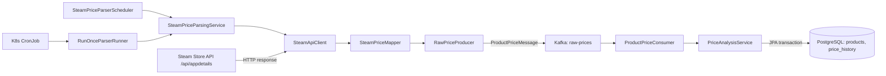

# Реализованная архитектура

Документ сверён с исходниками commit `ab635693ca71375ea41b76ad44369a3c88440dbe`
для [DOC-01](https://github.com/OlgaMoss/price-tracker/issues/25).
Это описание кода, а не подтверждение развёртывания или успешного сквозного запуска.
[Режимы запуска и конфигурация](running.md) описаны отдельно.

## Модули и приложения

[settings.gradle](../settings.gradle) подключает `common`, `parser-service`, `analytics-service`.
[build.gradle](../build.gradle) задаёт Java toolchain 26 и Spring Boot plugin 4.1.0.

| Модуль | Роль и исходники |
| --- | --- |
| `common` | Java-библиотека: [build.gradle](../common/build.gradle), общий DTO [ProductPriceMessage](../common/src/main/java/io/github/solar/common/dto/ProductPriceMessage.java). Собственного приложения нет |
| `parser-service` | Boot plugin в [build.gradle](../parser-service/build.gradle); entry point [ParserServiceApplication.main](../parser-service/src/main/java/io/github/solar/parser/ParserServiceApplication.java). Включает scheduling и привязку `SteamParserProperties` |
| `analytics-service` | Boot plugin в [build.gradle](../analytics-service/build.gradle); entry point [AnalyticsServiceApplication.main](../analytics-service/src/main/java/io/github/solar/analytics/AnalyticsServiceApplication.java) |

Оба сервиса зависят от `common`. Корневой проект отдельного Boot приложения не содержит.

## Фактический поток

Диаграмма показывает передачу данных и вызовы обработки, а не порядок старта процессов.
Scheduler и RunOnce — альтернативные инициаторы одного обхода; CronJob запускает процесс RunOnce.
Планируемые компоненты в диаграмму не включены.

| Этап | Реализация и подтверждение |
| --- | --- |
| HTTP-запрос | [SteamApiClient.fetchAppDetails](../parser-service/src/main/java/io/github/solar/parser/client/SteamApiClient.java): GET `appdetails` с `appids`, `cc` (страна) и `l=russian`. [ParserBeanConfig](../parser-service/src/main/java/io/github/solar/parser/config/ParserBeanConfig.java) создаёт `RestClient` и `ObjectMapper` |
| Обход | [SteamPriceParsingService.parseAndPublishAll](../parser-service/src/main/java/io/github/solar/parser/service/SteamPriceParsingService.java) последовательно обходит настроенные `appIds`, выдерживает задержку между запросами. Пустой результат пропускается; исключение прерывает текущий обход |
| Маппинг | [SteamPriceMapper.toProductPriceMessage](../parser-service/src/main/java/io/github/solar/parser/mapper/SteamPriceMapper.java) создаёт `steam-{appId}`, название, цену и URL магазина. При `is_free=true` цена `0.00`; платная игра без блока цены пропускается. Иначе используется `BigDecimal.valueOf(finalPrice, 2)` |
| Публикация | [RawPriceProducer.publish](../parser-service/src/main/java/io/github/solar/parser/kafka/RawPriceProducer.java) вызывает `KafkaTemplate.send(...).get()`. Ключ — `externalId`, топик из `steam.parser.kafka-topic`, по умолчанию `raw-prices` |
| Потребление | [ProductPriceConsumer.listenProductPrices](../analytics-service/src/main/java/io/github/solar/analytics/kafka/ProductPriceConsumer.java) слушает литерал `raw-prices`, группа `analytics-group`; вызывает `PriceAnalysisService`, оборачивает ошибки в `KafkaMessageProcessingException` |
| Хранение | [PriceAnalysisService.analyzePrice](../analytics-service/src/main/java/io/github/solar/analytics/service/PriceAnalysisService.java) имеет `@Transactional`. [ProductRepository](../analytics-service/src/main/java/io/github/solar/analytics/repository/ProductRepository.java) ищет по `externalId`; [PriceHistoryRepository](../analytics-service/src/main/java/io/github/solar/analytics/repository/PriceHistoryRepository.java) сохраняет историю |

## Контракт и идентичность товара

[ProductPriceMessage](../common/src/main/java/io/github/solar/common/dto/ProductPriceMessage.java)
содержит только `externalId`, `title`, `price` (`BigDecimal`), `url`.
JSON producer/consumer настроены в [parser application.yaml](../parser-service/src/main/resources/application.yaml)
и [analytics application.yaml](../analytics-service/src/main/resources/application.yaml).

Страна задаётся в HTTP-запросе, но не передаётся в Kafka и не хранится в БД.
Поле `currency` есть в [SteamPriceOverview](../parser-service/src/main/java/io/github/solar/parser/dto/SteamPriceOverview.java),
но маппер его игнорирует. Контракт не содержит явной бесплатности, `eventId` или времени наблюдения.
[SteamAppData](../parser-service/src/main/java/io/github/solar/parser/dto/SteamAppData.java) использует
primitive `boolean` для бесплатности, а `SteamPriceOverview` — primitive `int` для цены:
отсутствие этих полей не различается со значениями по умолчанию. Полной проверки наблюдения нет.

[Product](../analytics-service/src/main/java/io/github/solar/analytics/entity/Product.java)
имеет уникальный `external_id`, построенный только по игре. Поэтому наблюдения одной игры
из разных стран не изолированы и могут обновлять одну запись. Нельзя считать сохранённые
суммы универсально рублёвыми: код масштабирует число на два знака, не сохраняя валюту.
Комментарий про рубли в `SteamPriceMapper` не отражает это ограничение.

## Текущее состояние и история цен

Правила задаёт [PriceAnalysisService](../analytics-service/src/main/java/io/github/solar/analytics/service/PriceAnalysisService.java):

| Случай | Товар | История |
| --- | --- | --- |
| Первое значение | Создание через `ProductMapper` | Первая запись |
| Уменьшение | Новая цена и `updatedAt`; лог о снижении | Новая запись |
| Увеличение | Новая цена и `updatedAt` | Новая запись |
| Численно равная цена | Без обновления | Без записи |

Сравнение выполняется через `BigDecimal.compareTo` с `Product.currentPrice`,
а не с историческим минимумом. Разница масштаба числа не считается изменением.
Название и URL существующего товара при обработке сообщения не обновляются.

[ProductMapper.toNewProduct](../analytics-service/src/main/java/io/github/solar/analytics/mapper/ProductMapper.java)
и сервис используют `LocalDateTime.now()`. `updatedAt` отражает создание/изменение при обработке,
а `checkedAt` истории — момент формирования исторической записи в аналитике.
Это не время наблюдения Steam; явная UTC-семантика не задана.

[Product](../analytics-service/src/main/java/io/github/solar/analytics/entity/Product.java)
соответствует `products`, а [PriceHistory](../analytics-service/src/main/java/io/github/solar/analytics/entity/PriceHistory.java)
— `price_history`: ID, ссылка на товар, цена и `checkedAt`. Обе цены имеют precision 10, scale 2.
История индексирована по `product_id`; валюта и страна отсутствуют в обеих сущностях.
Схема управляется `ddl-auto: update` в analytics YAML; версионированных миграций в репозитории нет.

Это история первого значения и изменений, а не всех уникальных наблюдений.
Пропуск равной цены не является дедупликацией событий. Позднее сообщение может изменить
актуальную цену; повтор старого сообщения после изменения может создать новую запись.
Четыре основных сценария отражены в [PriceAnalysisServiceTest](../analytics-service/src/test/java/io/github/solar/analytics/service/PriceAnalysisServiceTest.java);
наличие тестов не означает, что они запускались при подготовке документации.

## Снижения и границы надёжности

В `PriceAnalysisService.updateExistingProduct` снижение только логируется; публикация
в `price-drops` оставлена как TODO. `PriceDropEvent` и producer аналитики отсутствуют.
Producer-настройки в analytics YAML не означают реализованную публикацию.
Существующие JavaDoc про расчёт дельты и отчёты не подтверждают наличие таких функций.
Примеры в стандартах `CLAUDE.md` и `.cursorrules` иллюстрируют оформление тестов.

`RawPriceProducer` ждёт результат отправки и оборачивает ошибки в `PricePublishingException`.
`PriceAnalysisService` объединяет запись товара и истории JPA-транзакцией.
Эти механизмы не подтверждают атомарность PostgreSQL commit и Kafka offset commit.
В исходниках нет прикладных outbox, дедупликации по событию, `@Version`, политики DLT/replay
или согласованной политики восстановления. Поведение стандартных Kafka retry/ack зависит
от библиотеки и окружения; сквозные гарантии exactly-once, отсутствия потерь и автоматического
восстановления здесь не заявляются. `auto-offset-reset: earliest` в analytics YAML не является
гарантией повторного чтения всех сообщений при каждом запуске.

## Планы — не реализовано

| Компонент / возможность | Основание и граница текущего кода |
| --- | --- |
| `PriceDropEvent`, публикация `price-drops` | TODO в `PriceAnalysisService`; отправителя и класса события нет |
| `notification-service`, Telegram / Email / Console | Архитектурный план; модуль, приложение и обработчики отсутствуют |
| Страна, валюта и явная бесплатность в контракте/БД | [BUG-04](https://github.com/OlgaMoss/price-tracker/issues/12); текущие DTO и сущности этих атрибутов не сохраняют |
| Все уникальные корректные наблюдения, `observedAt`/`processedAt`, защита от поздних и конкурентных обновлений | [FEAT-04](https://github.com/OlgaMoss/price-tracker/issues/16); текущие контракт и сервис этого не реализуют |

BUG-04 и FEAT-04 не блокируют описание текущего состояния. После их реализации документация
обновляется вместе с соответствующими PR. В частности, только после FEAT-04 можно описывать
историю всех уникальных корректных наблюдений, включая неизменные, поздние и конфликтующие.
